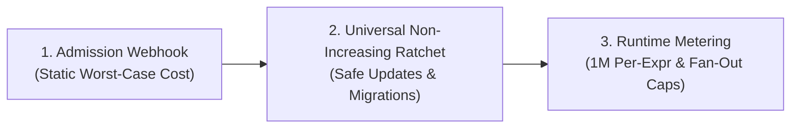

# CEL Cost Enforcement

Templates are tenant-authored, and rendering runs in the controller. Without a bound, a
single expression such as

```cel
${size(lists.range(2000).map(x, lists.range(2000).map(y, x + y)))}
```

(4M inner iterations, roughly a second of CPU) runs per evaluation, per expression, per
reconcile. The guards below bound that work at both **admission time** (static worst-case
estimation) and **render time** (runtime instruction metering and expansion limits). They
live in `internal/limits`, `internal/validation/cost`, `internal/template`, the rendering
pipelines under `internal/pipeline`, `internal/webhook`, and `internal/controller`.

Four layers cover what the others cannot see, plus a wall-clock backstop:

| Guard | Scope | Default | Error / Action |
|---|---|---|---|
| **Static admission check** | One expression / full template at write time | `1,000,000` / `5,000,000` units | Webhook rejects (`403 Forbidden`) or warns |
| `cel.CostLimit` | One expression at runtime | `1,000,000` units | `ErrCostLimitExceeded` |
| `CostBudget` | Attached: one reconcile; fallback: one `Render` | cost limit × 5 (`5,000,000` units) | `ErrCostBudgetExceeded` |
| Custom-function estimator | `oc_*` data traversal (static & runtime) | same tracker as the limit | (feeds the bounds above) |
| `forEach` caps | Per loop / cumulative per render | `250` / `2,000` | `ErrExpansionLimitExceeded` / admission rejection |
| Patch operations | Per component render | `2,000` | `ErrExpansionLimitExceeded` |
| `lists.range` size | Elements per call | `10,000` | plain evaluation error |
| Render timeout | Wall clock per rendering step | disabled (`0`) | `context.DeadlineExceeded` |

---

## Admission-time static cost estimation

Runtime guards stop an expensive render from wedging the controller, but they fire late —
during reconciliation, after the template has already been accepted and stored. Admission
webhooks close that feedback loop by computing a static worst-case cost estimate (`cel-go`
`env.EstimateCost`) whenever a `ComponentType`, `Trait`, `EndpointType`, `ResourceType`, or
`Workflow` (or their cluster-scoped equivalents) is created or updated.



### Schema-aware sizing (KEP-2876 model)

Static cost depends on the maximum size of every collection and string an expression
traverses:

1. **Author-declared OpenAPI v3 bounds (`parameters` / `environmentConfigs`).**
   Structural schemas are converted into CEL `DeclType` definitions via `internal/validation/schemautil`.
   Any array iterated in a CEL comprehension (`.map()`, `.filter()`, `.all()`, `.exists()`)
   or `forEach` loop **must declare `maxItems`** in its `openAPIV3Schema` (and maps must
   declare `maxProperties`).
2. **Pessimistic fallback for unbounded fields.**
   Following Kubernetes KEP-2876, if a schema field omits `maxItems`, `maxProperties`, or
   `maxLength`, the static estimator falls back to the physical object payload ceiling
   (`MaxObjectSizeBytes = 1.5 MiB`, i.e., `524,287` list elements, `314,572` map entries,
   or `1,572,862` characters). Constant-time `O(1)` copy-through expressions
   (such as `${parameters.items}`) remain cheap and pass admission, whereas iterating over
   an unbounded collection immediately exceeds the `1,000,000` per-expression limit and
   produces a remediation message naming the exact schema field that needs `maxItems`.
3. **Platform context reflection (`workload`, `environment`, `project`, `metadata`).**
   Platform-supplied variables have no author-declared schema. Their CEL `DeclType` bounds
   are derived directly from the Kubebuilder validation markers on the Go API structs in
   `api/v1alpha1` (via `internal/validation/decltype` and embedded CRDs in `config/crd`):
   - `workload.container.env` / `configurations.configs.envs`: `1,024` items
   - `workload.container.files` / `configurations.configs.files`: `256` items
   - `workload.endpoints` / `workload.toServicePorts`: `128` items
   - `workload.dependencies.endpoints` / `dependencies.items`: `50` items
   - `backends` / `backendRefs`: `16` items
   - `metadata.podSelectors`: `8` entries
   - `metadata.labels` / `metadata.annotations`: unbounded (`O(1)` key lookup permitted;
     comprehension iteration rejected)
4. **Multiplicative `forEach` scaling.**
   When a resource template or trait rule declares `forEach: ${...}`, the static cost of
   every inner expression is multiplied by the upper bound of the `forEach` collection
   (capped at `250` items per loop and `2,000` cumulative expansions per render).

### Universal non-increasing ratchet (compatibility for existing templates)

To ensure existing or legacy templates can be updated safely without downtime, admission
updates are governed by a universal non-increasing ratchet (`JudgeRatchet` in
`internal/validation/cost/ratchet.go`):

$$\text{Verdict Rank: } \text{WithinBudget (1)} < \text{OverBudget (2)} < \text{UnknownBounds (3)}$$

- **WithinBudget (Rank 1):** Always admitted.
- **Rank improvement:** Admitted (for example, adding `maxItems` to move from
  `UnknownBounds` to `OverBudget` or `WithinBudget`).
- **Retained OverBudget (Rank 2):** Admitted on `UPDATE` if and only if the new worst-case
  cost does not exceed the previous cost ($\text{Cost}_{\text{new}} \le \text{Cost}_{\text{old}}$).
- **Regression:** Rejected. Moving from `WithinBudget` to `OverBudget`, or increasing the
  cost of an already over-budget template, fails admission with delta diagnostics.

### Fixing common admission rejections

#### 1. Missing `maxItems` on an iterated parameter
```text
ComponentType "router" CEL cost verdict: OVER BUDGET (estimated cost 14680065 / budget 1000000)
Missing OpenAPI Schema Constraints Detected:
• Field "parameters.routes" has no maxItems in the openAPIV3Schema...
```
**Fix:** Declare an explicit `maxItems` bound in `openAPIV3Schema`:
```yaml
spec:
  parameters:
    openAPIV3Schema:
      type: object
      properties:
        routes:
          type: array
          maxItems: 50
          items:
            type: string
```

#### 2. Nested comprehensions ($O(N^2)$ / $O(N^3)$)
```text
ComponentType "heavy-app" CEL cost verdict: OVER BUDGET (estimated cost 2001001 / limit 1000000)
Violations & Remediation Guidance:
  * Resource "deployment": nested loops over collections: Fix: set maxLength on elements, lower maxItems in openAPIV3Schema, or avoid nesting loops over the same field
```
**Fix:** Avoid nesting `.map()` / `.filter()` over the same collection, or tighten `maxItems`
on the outer and inner arrays so the product stays well below `1,000,000` units.

---

## Per-expression cost limit

Every CEL program is compiled and run with `cel.CostLimit`. cel-go meters each evaluation
and aborts once the accumulated cost passes the limit, so no single expression can run
away regardless of how the inputs are shaped.

The `1,000,000` default (`limits.DefaultCELCostLimit`, matching Kubernetes KEP-2876's
per-rule budget) provides over an order of magnitude of headroom above the heaviest
expression in the shipped `ComponentType`, `Trait`, `ResourceType`, `EndpointType`, and
`Workflow` corpus (~82,000 static units; ~36,000 runtime units) while keeping worst-case
evaluation below Go's heap allocation cliff. If a legitimate template trips the limit,
raise it with `--cel-cost-limit` (below) and file the template as a data point.

## Cumulative cost budget

A per-expression limit alone is bypassed by volume: a large CR of individually cheap
expressions costs the same as one expensive one. `CostBudget` is a per-reconcile pool that
every evaluation charges against, seeded on the reconcile context by each rendering
reconciler and shared by everything that renders during that reconcile — manifests, outputs
and each `readyWhen`.

The cumulative budget is `cost limit × 5` (`limits.RenderBudgetFactor = 5`, or `5,000,000`
units by default). When rendering happens outside a reconcile (tests, tools), the pipeline
falls back to a budget of its own so the bound is never simply absent.

Once the budget is exhausted, further evaluations are refused before they run rather than
after. A concrete failure is still named ahead of the breach: if an expression fails on its
own terms, the operator sees that error, and the breach surfaces on the next evaluation.

## Custom-function cost accounting

cel-go charges an unknown overload roughly O(1). The `oc_*` functions
(`oc_hash`, `oc_generate_name`, `oc_dns_label`, `oc_generate_name_limit`, `oc_merge`) walk
tenant data, so both the static `checker.CostEstimator` (at admission) and the runtime
`interpreter.ActualCostEstimator` (at render time) charge them by bytes or elements walked,
feeding the same tracker as the limit and the budget.

Dispatch is by function name, because `DynType` arguments block overload resolution.
**A new `oc_*` function ships unmetered unless it is added to
`customFunctionCostEstimator.CallCost` in `internal/template/custom_functions.go` and the
static estimator in `internal/validation/cost/call_cost.go`.**

Interpolation — the non-CEL string work that stitches `${...}` results back into a template
string — is done in a single pass with a byte builder. That work is invisible to cel-go's
meter, so it must stay linear in input and output size.

## Expansion guards

Fan-out happens *between* evaluations, where neither the single-expression limit nor the
CEL meter tracks resource multiplication: one cheap `forEach` expression can drive
thousands of sub-renders.

- **`forEach` item cap (`250` per loop, `limits.MaxForEachItemsPerLoop`).** Checked both
  statically at admission and before any copying or fan-out at runtime, so an oversized
  collection costs only the length check. It applies to every `forEach` — resource-level,
  trait create, trait patch and trait remove alike — because all of them funnel through
  `renderer.ToIterableItems`. `250` covers what templates actually iterate over: a
  component's config files, mounts, routes and containers.
- **Cumulative `forEach` cap (`2,000` per render, `limits.MaxForEachItemsPerRender`).**
  Many legal loops can recreate a large workload in total; this bounds their sum safely
  below the `2,048`-element Go heap/GC latency cliff. The per-loop cap cannot stand in for
  it, because the number of `forEach` sites is a product of nested arrays — a
  ComponentType's `resources`, and the `creates` of each trait bound to the component — and
  bounding each array on its own leaves their product free to grow.
- **Patch operation cap (`2,000` per component render, `limits.MaxPatchOperations`).**
  Counts targets × operations, so a trait patching many targets is bounded even when each
  patch is small. The error names the running total the batch would have reached, which is
  what tells an operator whether they are marginally or wildly over.
- **`lists.range()` size cap (`10,000` elements, `limits.MaxListsRangeSize`).** cel-go's
  own metering charges `lists.range` only *after* it allocates the whole slice, so the cost
  limit cannot interrupt the allocation. The cap is checked before it, and is therefore
  load-bearing. cel-go raises it as an ordinary evaluation error, not a sentinel.

## Render timeout

A wall-clock backstop for work the cost model measures imperfectly (`split()` on very large
strings is nonlinear, and whole-collection references charge roughly constant). It is
**disabled by default**; the cost guards are the primary bound.

It applies to each rendering *step*, not to the reconcile: a reconcile that renders more
than once (manifests, outputs, each `readyWhen`) may spend it at each. The deadline is
derived inside each render entry point and released when it returns, so nothing accumulates
across a loop. Cluster reads are deliberately left outside it — a slow API server should not
surface as a template failure.

## Failure surface

A runtime breach is reported on the object's conditions, not only in the logs:
`Synced=False` / `ReleaseSynced=False` for manifest rendering, `OutputsResolved=False` for
outputs, `ResourcesReady=False` for `readyWhen`, and `WorkflowCompleted=False` with reason
`WorkflowRenderingFailed` for a WorkflowRun. When `ComponentRelease` creation or rendering
fails during auto-deploy, `FormatAutoDeployError` (`internal/controller/component/rejection_formatter.go`)
classifies the failure into developer parameter errors, template schema drift, platform
budget breaches, or transient cluster errors onto `Component.status.conditions`.

Retries then follow each reconciler's pre-existing behavior — controller-runtime's per-key
exponential backoff. Every retry is itself bounded by the same guards, so a repeating
breach costs one cost-limited render.

Two properties make that safe:

**Messages are deterministic.** The recursive render walks map keys in sorted order and
stops at the first failing expression, so the expression named in the error does not follow
Go's randomized map iteration, and the breach message carries no live spend. An unchanged
object therefore produces a byte-identical condition on every reconcile, the status write
no-ops, and no watch event is generated — a failing object does not self-trigger a loop.

**Messages are bounded.** A tenant-authored expression may be hundreds of KB, and an
oversized or invalid-UTF-8 condition is rejected by the API server, which would mean the
breach is never recorded at all. Fragments are truncated at 256 bytes on a rune boundary,
with the marker counted inside the bound. Every layer that re-quotes tenant input routes
through the same helper (`template.TruncateFragment`), aggregated post-render failures are
capped at 20 entries, and `controller.NewCondition` bounds whatever it is handed at 8192
bytes as a backstop.

```go
// internal/controller/conditions.go
const maxConditionMessageLen = 8192
Message: template.TruncateTo(message, maxConditionMessageLen),
```

## Configuration

Settings are cluster-wide, applied to the admission webhooks and rendering reconcilers.

| Flag | Environment variable | Helm value | Flag default | Chart default |
|---|---|---|---|---|
| `--cel-cost-limit` | `CEL_COST_LIMIT` | `controllerManager.manager.celCostLimit` | `0` (built-in `1000000`) | `1000000` |
| `--render-timeout` | `RENDER_TIMEOUT` | `controllerManager.manager.renderTimeout` | `0` (disabled) | `"0"` |
| *(env only)* | `CEL_COST_MODE` | — | `warn` (`warn`, `enforce`, `off`) | — |
| `--schema-default-max-items` | `OPENCHOREO_SCHEMA_DEFAULT_MAX_ITEMS` | — | `0` (disabled; strict KEP-2876) | — |
| `--schema-default-max-properties` | `OPENCHOREO_SCHEMA_DEFAULT_MAX_PROPERTIES` | — | `0` (disabled; strict KEP-2876) | — |
| `--schema-default-max-length` | `OPENCHOREO_SCHEMA_DEFAULT_MAX_LENGTH` | — | `0` (disabled; strict KEP-2876) | — |
| `--schema-default-map-key-max-length` | `OPENCHOREO_SCHEMA_DEFAULT_MAP_KEY_MAX_LENGTH` | — | `253` | — |

The two cost-limit defaults describe the same bound. `0` means "use the built-in limit",
and the chart states that limit — `limits.DefaultCELCostLimit` in `internal/limits/limits.go`
— outright, so an operator reading `values.yaml` sees the number rather than an indirection.
The two therefore have to be changed together. The chart omits the flag entirely when the
value is `0`, so an operator can still hand the decision back to the controller.

To switch admission enforcement between warning and blocking modes during rollout:

```bash
# Log admission warnings without blocking template writes:
kubectl -n openchoreo-control-plane set env deployment/controller-manager CEL_COST_MODE=warn

# Enforce strict admission rejection (403 Forbidden on budget breach):
kubectl -n openchoreo-control-plane set env deployment/controller-manager CEL_COST_MODE=enforce
```

Operators who prefer automatic platform fallback bounds when authors omit `maxItems`,
`maxProperties`, or `maxLength` in `openAPIV3Schema` can opt in via
`OPENCHOREO_SCHEMA_DEFAULT_MAX_ITEMS=1000`, `OPENCHOREO_SCHEMA_DEFAULT_MAX_PROPERTIES=1000`,
and `OPENCHOREO_SCHEMA_DEFAULT_MAX_LENGTH=4096`. When enabled, the same bounds are enforced
on developer inputs (`ApplyDefaultBoundsToJSONSchema`) and admission webhooks emit a warning
listing each field where a default bound was assumed.

The two modes intentionally optimize for different goals:

| Mode | Omitted-bound behavior | Optimizes for |
|---|---|---|
| **Default (`0/0/0`, strict KEP-2876)** | Falls back to the ~1.5 MiB physical payload ceiling, so comprehensions / `split` / `oc_merge` over unbounded fields exceed `1,000,000` | **High authoring discipline** — naturally nudges platform engineers to declare explicit `maxItems`/`maxProperties`/`maxLength` whenever a field drives super-constant CEL work |
| **Opt-in (`1000/1000/4096`)** | Injects and enforces platform defaults on both static estimation and developer-input validation | **High platform safety** — closes structural validation gaps cluster-wide without forcing authors to bound every linear loop (lower authoring discipline, since linear work over 1,000 items passes under `1,000,000`) |

A malformed environment value fails startup rather than being silently replaced by the
default, and the Helm schema rejects an invalid duration at install time. Raising the cost
limit weakens the bound proportionally — the budget is derived from it — so treat it as an
escape hatch for a legitimate template, not a tuning knob.

## Known limitations

- **Mutually exclusive `includeWhen` resources:** When a template defines mutually exclusive
  resources (for example, `includeWhen: ${parameters.mode == "a"}` vs
  `includeWhen: ${parameters.mode == "b"}`), the static aggregator conservatively sums the
  cost of all resources rather than partitioning mutually exclusive branches.
- **OpenAPI composition unions (`oneOf` / `anyOf`):** The CEL schema normalizer synthesizes
  the maximum upper bound (`maxItems`, `maxProperties`, `maxLength`) across union branches
  onto the enclosing type; branch-specific field discrimination falls back to worst-case
  branch bounds. (`allOf` intersections take the minimum explicitly declared bound across
  branches, recursively across overlapping properties.)
- **Unbounded `forEach` loops (warn vs. enforce open question):** Because `forEach` loop
  bounds are clamped at `M = min(sizeEst.Max, 250)` — matching the runtime renderer's
  250-item per-loop cap — an unfiltered `forEach: ${parameters.items}` with a small loop body
  and no `maxItems` is compute-sound (`250 × body < budget`) and therefore admitted with an
  actionable warning (distinguishing missing bounds from explicit bounds `> 250`) rather than
  hard-rejected. Hard-rejecting `ForEachCapExceeded` unconditionally would false-positive on
  filtered loops like `parameters.items.filter(i, i.enabled)` and break existing unbounded
  sample templates. If maintainers later want `enforce` mode to require explicit bounds on
  `forEach` inputs, the clean path is to reject only unfiltered direct paths, include
  `ForEachCapExceeded` in the update ratchet, and add explicit `maxItems` to the built-in
  getting-started templates.
- **Authorization CEL runtime:** The authorization engine (`internal/authz`) is separate
  from template rendering and is not covered by these template guards.
- **Whole-collection copy-through:** Whole-collection identifier references
  (`${parameters.foo}`) charge `O(1)` in CEL cost metering because no comprehension loop is
  executed; payload size is bounded instead by the Kubernetes API server's 1.5 MiB request
  limit and structural OpenAPI validation at `ComponentRelease` creation.
