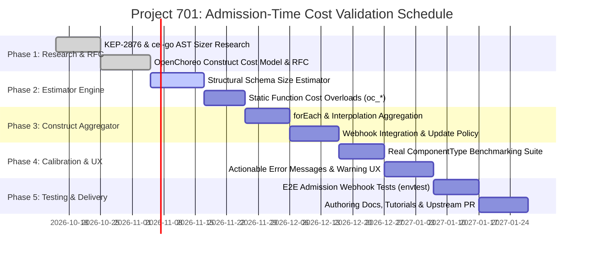

# Research & Technical Architecture: Admission-Time Cost Validation for CEL Templates in OpenChoreo

**Project**: Project 701 — Admission-Time Cost Validation for CEL Templates in OpenChoreo  
**Author**: Sachin Lakshitha  
**Mentor**: Chathuranga Dassanayake  
**Duration**: 3 Months (12 Weeks)  
**Target Codebase Paths**:
- `internal/validation/component/` (AST validation, environment generation, structural schema integration)
- `internal/validation/component/cost/` (New module: Schema-aware cost estimator & sizers)
- `internal/template/` (CEL engine, custom function static cost models, budgets)
- `internal/webhook/{componenttype,trait}/` (Admission webhooks, warning / rejection handlers)

---

## 1. Executive Summary & Architecture

OpenChoreo Platform Engineers (PEs) author **ComponentTypes** and **Traits** containing CEL expressions within Kubernetes resource templates, along with OpenAPI v3 schemas specifying parameters.

### The Problem
* **Type-checking is early (admission-time)**: [cel_validator.go](file:///c:/Users/sachin%20lakshitha/openchoreo/internal/validation/component/cel_validator.go) validates CEL types using `apiservercel.DeclTypeProvider` and `apiextschema.Structural`.
* **Cost validation is late (reconcile-time)**: [budget.go](file:///c:/Users/sachin%20lakshitha/openchoreo/internal/template/budget.go) and [engine.go](file:///c:/Users/sachin%20lakshitha/openchoreo/internal/template/engine.go) calculate execution cost inside the controller reconciler using cel-go runtime cost trackers (`customFunctionCostEstimator`).
* **The Vulnerability & Friction**:
  - Authors receive zero early feedback on expensive expressions (e.g. unbounded loops, nested comprehensions).
  - Authors are not incentivized to specify parameter bounds (`maxItems`, `maxLength`, `maxProperties`).
  - Workload deployment failure occurs downstream during reconciliation, causing operational friction.

### The Solution: Schema-Aware Worst-Case Static Cost Estimation
Adopting Kubernetes KEP-2876 principles, OpenChoreo will compute worst-case CEL cost estimates during admission webhook evaluation (`ValidateCreate` and `ValidateUpdate`). By inspecting OpenAPI v3 parameter schemas and structural bounds, unconstrained or excessively expensive templates will be rejected with clear, actionable recommendations.

```
                              ┌────────────────────────────────────────────────────────┐
                              │            Admission Webhook Request                   │
                              │     (ComponentType / ClusterComponentType / Trait)     │
                              └──────────────────────────┬─────────────────────────────┘
                                                         │
                                                         ▼
                               ┌───────────────────────────────────────────────────┐
                               │           Schema Extraction & Conversion          │
                               │  schemautil.ExtractAndValidateSchemas(...)        │
                               │  -> Structural Parameters & EnvironmentConfigs    │
                               └─────────────────────────┬─────────────────────────┘
                                                         │
                                                         ▼
                               ┌───────────────────────────────────────────────────┐
                               │          OpenChoreo Schema Cost Sizer             │
                               │  Traverse OpenAPI structural bounds:              │
                               │   - Array: declared maxItems (fallback: default)  │
                               │   - String: declared maxLength (fallback: default)│
                               │   - Map: declared maxProperties (fallback: def)   │
                               │   - Platform variables: Synthetic bounds          │
                               └─────────────────────────┬─────────────────────────┘
                                                         │
                                                         ▼
                               ┌───────────────────────────────────────────────────┐
                               │         CEL Static Cost Estimator Engine          │
                               │  - cel.EstimateCost(ast, costEstimator)           │
                               │  - Static Custom Function Models (oc_hash, etc.)  │
                               │  - Aggregator for Template Constructs:            │
                               │      * String Interpolation: sum(sub_exprs) + cat │
                               │      * forEach Expansion: maxItems * cost(body)   │
                               │      * includeWhen / validations: boolean cost    │
                               └─────────────────────────┬─────────────────────────┘
                                                         │
                                      ┌──────────────────┴──────────────────┐
                                      │                                     │
                                      ▼                                     ▼
                        [ Total Cost <= Budget ]              [ Total Cost > Budget ]
                                      │                                     │
                                      ▼                                     ▼
                            [ Admission Allowed ]                 [ Admission Rejected / Warned ]
                                                                  "Field 'spec.resources[0].template':
                                                                   estimated cost (45,200) exceeds
                                                                   budget (10,000). Add 'maxItems' to
                                                                   'parameters.routes' or simplify."
```

---

## 2. In-Depth Research: Kubernetes KEP-2876 & cel-go Internals

### 2.1. cel-go Cost Estimation Mechanism
`cel-go` provides static cost estimation through:
- `checker.CostEstimator`: An interface invoked during AST analysis.
- `cel.EstimateCost(ast, estimator, options...)`: Evaluates lower and upper bound costs of evaluating an expression.
- `cel.SizeEstimator`: Calculates the maximum length of collections and strings based on variable declarations:
  ```go
  type SizeEstimator interface {
      EstimateSize(element *ast.AST) *SizeEstimate
  }
  ```
- `checker.FunctionCostEstimator`: Overrides the static cost of built-in and extension functions based on their AST argument sizes.

### 2.2. OpenAPI v3 Structural Bounds Mapping
`k8s.io/apiextensions-apiserver/pkg/apiserver/schema` represents Kubernetes structural schemas. We map properties as follows:

| OpenAPI v3 Schema Property | cel-go Size Metric | Pessimistic Default (when unbounded) |
| :--- | :--- | :--- |
| `items`, `maxItems` | `SizeEstimate.Max` for Lists | **100** (calibrated against typical CRD bounds) |
| `properties`, `maxProperties` | `SizeEstimate.Max` for Maps | **50** |
| `maxLength` | `SizeEstimate.Max` for Strings | **1,024** characters |
| `format: int64 / int32` | Primitive integer | 1 unit |
| `oneOf / anyOf / allOf` | Max of composite branch costs | Evaluated branch maximum |

---

## 3. Cost Modeling for OpenChoreo Constructs

### 3.1. `forEach` Loops
A resource template or patch with a `forEach` loop executes its nested body once per item:
$$\text{Cost}(\text{ForEachResource}) = \text{Cost}(\text{ForEachExpr}) + \text{Cost}(\text{IncludeWhen}) + \left( N_{\text{maxItems}} \times \sum_{e \in \text{TemplateBody}} \text{Cost}(e) \right)$$

*If `ForEachExpr` iterates over `parameters.containers` without `maxItems`, $N_{\text{maxItems}} = 100$, causing $\text{Cost}$ to scale $100\times$. This immediately triggers admission rejection, prompting the author to declare `maxItems: 5`.*

### 3.2. String Interpolation (`${...}`)
Template strings can contain multiple expressions (e.g., `"${spec.name}-${parameters.env}:${parameters.tag}"`):
$$\text{Cost}(\text{InterpolatedString}) = \sum_{i=1}^{k} \text{Cost}(\text{Expr}_i) + \text{Cost}(\text{StringConcat}) \times k$$
Parsed via [FindCELExpressions](file:///c:/Users/sachin%20lakshitha/openchoreo/internal/template/engine.go#L281).

### 3.3. OpenChoreo Custom Functions (`oc_*`)
Currently, [custom_functions.go](file:///c:/Users/sachin%20lakshitha/openchoreo/internal/template/custom_functions.go) only implements runtime `ActualCostEstimator` for `program.ContextEval`. We will implement static `FunctionCostEstimator` for admission estimation:

1. `oc_hash(str)`: $\text{BaseCost}(1) + \lceil \text{MaxLength}(str) \times 0.1 \rceil$
2. `oc_generate_name(str | list)` / `oc_dns_label`: $\text{BaseCost}(1) + \text{Size}(input) + \lceil \text{ByteLength}(input) \times 0.1 \rceil$
3. `oc_merge(map1, map2)`: $\text{BaseCost}(1) + \text{MaxProps}(map1) + \text{MaxProps}(map2)$
4. `oc_omit()`: Constant $1$ unit.

### 3.4. Platform Context Variables
Variables (`workload`, `metadata`, `trait`) are populated by the platform:
- We define synthetic structural schemas bounding platform context properties (e.g., `workload.spec.containers`: `maxItems: 32`, `metadata.name`: `maxLength: 253`).

---

## 4. 12-Week Phased Milestone Roadmap



### Detailed Breakdown

| Phase & Timeline | Objective | Deliverables & Code Changes |
| :--- | :--- | :--- |
| **Phase 1: Research & RFC**<br>*(Weeks 1–3)* | Formalize cost algorithm, bounds derivation, and OpenChoreo RFC | • Complete research report on `k8s.io/apiserver/pkg/cel` cost estimation.<br>• RFC submitted to OpenChoreo working group specifying construct cost formulas, budget defaults, and upgrade policies. |
| **Phase 2: Estimator Engine**<br>*(Weeks 4–6)* | Build core schema-aware AST cost estimator | • New package `internal/validation/component/cost/`.<br>• `SchemaSizeEstimator` resolving OpenAPI structural bounds to CEL `SizeEstimate`.<br>• Static cost estimators for custom functions (`oc_hash`, `oc_merge`, `oc_generate_name`, `oc_dns_label`).<br>• Unit test suite validating cost bounds on complex CEL expressions. |
| **Phase 3: Construct Aggregator & Webhook**<br>*(Weeks 7–8)* | Aggregate template tree cost & integrate into admission webhooks | • Tree-walking cost aggregator for `ResourceTemplate`, `TraitCreate`, and `TraitPatch`.<br>• `forEach` multiplier logic incorporating loop variable sizing.<br>• Integration into `ComponentType`, `ClusterComponentType`, `Trait`, and `ClusterTrait` webhooks ([componenttype/webhook.go](file:///c:/Users/sachin%20lakshitha/openchoreo/internal/webhook/componenttype/webhook.go), [trait/webhook.go](file:///c:/Users/sachin%20lakshitha/openchoreo/internal/webhook/trait/webhook.go)).<br>• Update policy: enforce on new/modified templates; warn or grandfather untouched legacy specs. |
| **Phase 4: Calibration & Error Reporting**<br>*(Weeks 9–10)* | Benchmark against real samples & polish error reporting UX | • Benchmark test harness evaluating all samples in `samples/` and real-world ComponentTypes.<br>• Calibrated budget thresholds ($B_{\text{expression}} \approx 10^4$, $B_{\text{resource}} \approx 5 \times 10^4$).<br>• Rich error messages with actionable hints guiding PEs to specify `maxItems`/`maxLength`. |
| **Phase 5: E2E Testing & Upstream PR**<br>*(Weeks 11–12)* | Production readiness, documentation, and PR review | • `envtest` suites for webhook admission.<br>• PE documentation: *Best Practices for Template Authors & Schema Bounds*.<br>• Code cleanup, linting, and final PR merge with mentor review. |

---

## 5. Budget Calibration & Actionable Error UX

### 5.1. Proposed Budget Thresholds
* **Per-Expression Budget ($B_{\text{expr}}$)**: `10,000` CEL cost units.
* **Per-Resource Budget ($B_{\text{res}}$)**: `50,000` CEL cost units (bounds aggregate of all expressions in a single resource template, including `forEach` loops).
* **Per-ComponentType/Trait Budget ($B_{\text{spec}}$)**: `200,000` CEL cost units.

### 5.2. Error Message Design
Clear guidance directs the Platform Engineer on how to fix the violation:

```
Error: admission webhook "vcomponenttype-v1alpha1.kb.io" denied the request:
ComponentType.openchoreo.dev "microservice" is invalid:
spec.resources[0].template.spec.containers: Invalid value:
  Expression: "${parameters.routes.map(r, r.path)}"
  Estimated Cost: 24,500 (exceeds per-expression budget of 10,000)
  Reason: Field 'parameters.routes' is unbounded.
  Recommendation: Add 'maxItems' (e.g. maxItems: 10) to the schema for 'parameters.routes' or simplify the CEL expression.
```

---

## 6. Backward Compatibility & Upgrade Policy

1. **New Resources (`ValidateCreate`)**: Full strict enforcement of cost budgets.
2. **Resource Updates (`ValidateUpdate`)**:
   - If the CEL expressions and parameter schemas are **unchanged** in the update, skip cost rejection or emit an admission warning (`admission.Warnings`) so existing clusters are not broken.
   - If expressions or schemas are modified, enforce strict cost budgets.
3. **Opt-Out / Tuning Annotations**: Support optional cluster-level or resource-level annotation overrides for transitional migrations if required by administrators.
