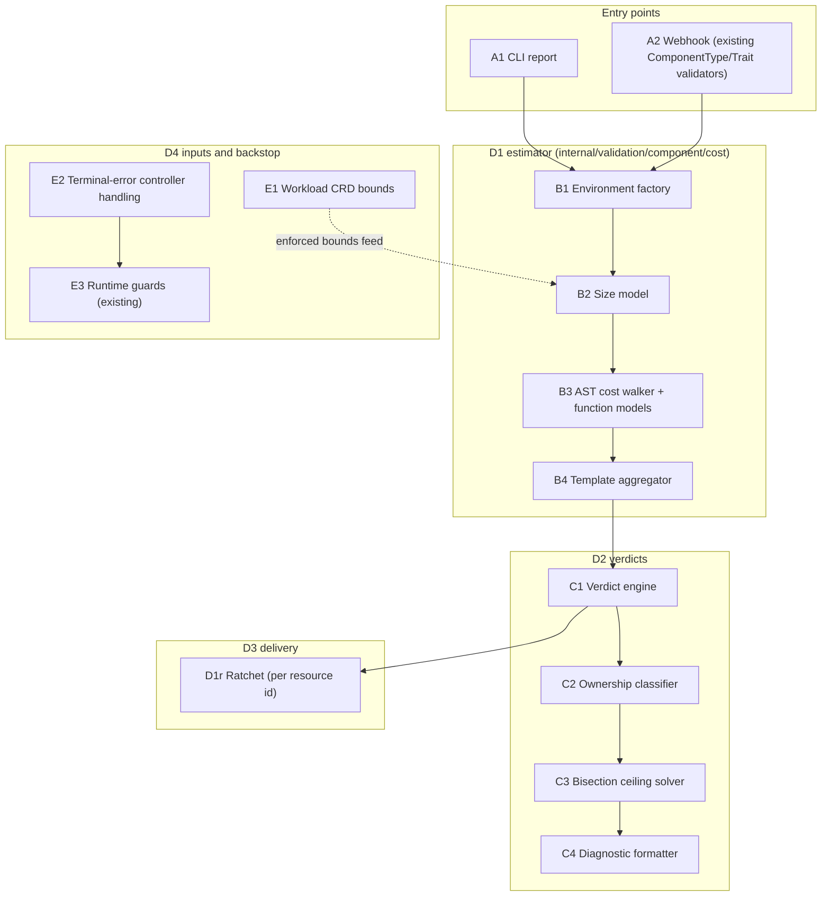
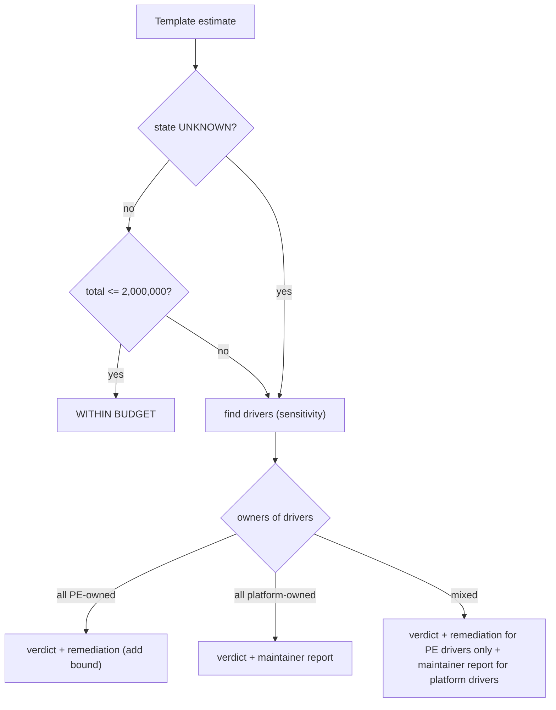
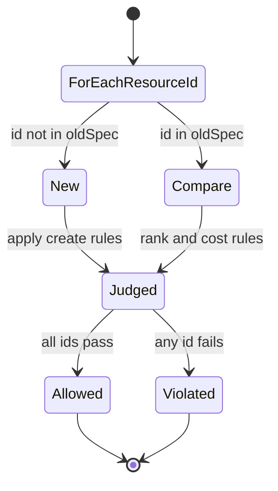
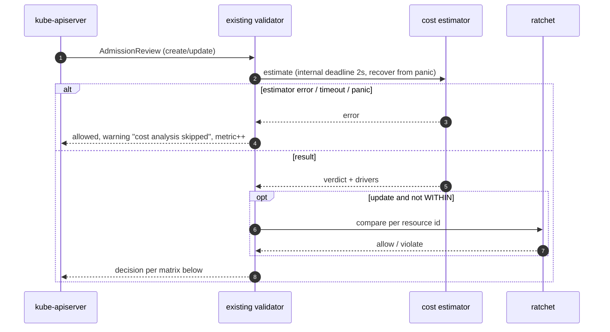
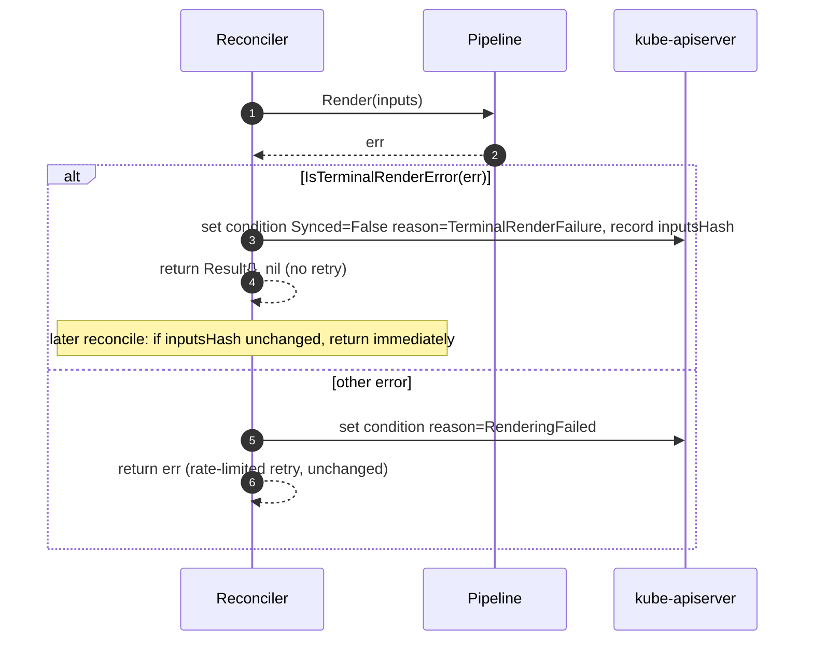
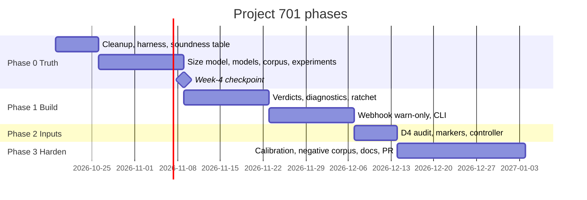

# Project 701 — Solution Design and Execution Plan
---

## 1. What this project delivers

OpenChoreo templates (ComponentType, ClusterComponentType, Trait, ClusterTrait) contain CEL. Today the cost of those expressions is checked only at render time inside the controller. This project delivers four things, in this order of priority:

| ID | Deliverable | One-line purpose |
|---|---|---|
| D1 | Sound estimator | Compute a worst-case CEL cost for a template that is never below runtime cost, or say UNKNOWN. |
| D2 | Verdicts and ownership-aware diagnostics | Tell the author WITHIN / OVER / UNKNOWN and who can fix it. |
| D3 | Delivery | Report CLI, warn-only webhook, per-resource ratchet. Runtime guards stay as backstop. |
| D4 | Input bounding and controller fix | Bound developer-supplied Workload collections. Stop retrying deterministic render failures. |

### 1.1 Design principles (binding)

1. **Soundness over coverage.** If the estimator cannot prove an upper bound it returns UNKNOWN. It never guesses and never adds a margin.
2. **One environment factory.** Webhook, CLI, and test harness build CEL environments through the production constructor. No hand-built environments.
3. **UNKNOWN is a first-class value.** No raw `uint64` arithmetic on a saturated value.
4. **Unenforced bounds are not facts.** A bound that no schema marker or runtime guard enforces is treated as UNKNOWN by default. Policy bounds are opt-in.
5. **Blame the owner.** "Add maxItems" is shown only for PE-owned drivers.
6. **Warn first.** Nothing rejects until the soundness gate in §8 passes and a maintainer flips the flag.

### 1.2 What the project does not claim

- No security claim. Template authors are trusted cluster actors.
- The estimator does not replace runtime guards. It gives early feedback; the runtime guard is the only layer that sees real values.
- No byte-size or blast-radius estimator in v1. Rendered output lands in one `RenderedRelease` object; its size ceiling is tested in experiment R6 (§7) and reported, not modeled.
- No bypass annotation in v1.

---

## 2. Evidence the design rests on

| # | Fact | Source |
|---|---|---|
| 1 | Runtime per-expression limit is 2,000,000 | `[V internal/template/engine_cache.go:61]` |
| 2 | Runtime cumulative budget per render is 2,000,000 × factor 1 | `[V internal/template/budget.go:126]`, `[V engine_cache.go:81]` |
| 3 | forEach caps: 100 per loop, 10,000 per render; both return `ErrExpansionLimitExceeded` (error, not truncate) | `[V internal/pipeline/component/renderer/foreach.go:23,32,66-68,80-84]` |
| 4 | Corpus: 703 expressions from 13 sample types, 0 skipped under production env. 66 exceed 10,000 static cost and all 66 are driven by platform-owned variables. ~41 are UNKNOWN (39 saturated plus 2 values at 0.1×/0.2× MaxUint64). | MEASURED, research/findings.md |
| 5 | The estimator is unsound on one expression: static 33,294, runtime 33,336 | MEASURED, findings.md |
| 6 | The same expression's 33,294 is dominated by the default list size 1,000 on `ep.visibility` times the CHOSEN bound 32 on endpoints | `[V decltype/reflect.go:14]`, MEASURED |
| 7 | Workload CRD has no bound on `Container.Env`, `Container.Files`, `WorkloadTemplateSpec.Endpoints`; dependencies have MaxItems=50 | `[V api/v1alpha1/workload_types.go:75,79,215,224,306]` |
| 8 | `ReleaseBinding` returns a plain error on every render failure; `IsTerminalRenderError` is defined but not used there | `[V controller.go:564-571]`, `[V errors.go:40-44]` |
| 9 | `WorkflowRun` returns `Requeue: true` on render failure; `ProjectReleaseBinding` and `ResourceReleaseBinding` return `nil, nil` | `[V workflowrun/controller.go:277]`, `[V projectreleasebinding/controller_render.go:66]`, `[V resourcereleasebinding/controller.go:253]` |
| 10 | `ReleaseBinding` `For()` has no generation predicate | `[V controller.go:1601]` |
| 11 | `maxConcurrentReconciles` defaults to 1; Helm `renderTimeout` defaults to `"0"` | `[V helm/openchoreo-control-plane/values.yaml:772,794]` |
| 12 | Runtime cost 36,141 appears only in a code comment; the fixture that produced it is not in the repo | `[V engine_cache.go:45-47]`, `[U]` provenance |

**What the evidence implies.** Cost enters through platform-owned and developer-supplied inputs, not through PE `parameters`. The estimator has no signal on `samples/` until platform collections have size models. The only bounds the estimator may trust are bounds something enforces.

---

## 3. Architecture



*Diagram A. Component map. Every box has a contract in §4 (A1→4.9, A2→4.8, B1→4.1, B2→4.2, B3→4.3, B4→4.4, C1/C2/C3→4.5, C4→4.6, D1r→4.7, E1/E2→4.10, E3 is existing code listed in §2).*

**Decision: the webhook extends the existing validators.** The cost check is added inside the existing `ValidateCreate`/`ValidateUpdate` of the four kinds. No new webhook path. The existing `failurePolicy` is not changed (current value `[U]`, see §10 item 7).

---

## 4. Component specifications

### 4.1 Environment factory (B1)

| | |
|---|---|
| Purpose | Single source of CEL environments for webhook, CLI, tests. |
| Inputs | Template kind, schema options, optional forEach info per resource. |
| Outputs | `cel.Env`, `DeclTypeProvider`, error. |
| Decision | Add `(*CELValidator).ResourceEnvironment(resource) (*cel.Env, error)` that returns the base env, extended with the forEach variable when `forEach` is set. Delete the exported `AnalyzeForEachExpression` and `ExtendEnvWithForEach` currently added to `componenttype.go`. |
| Invariants | Environment contains `BaseCELExtensions()`, context fields, and custom functions. Harness and webhook call the same method. A compile failure is returned, never skipped. |
| Failure behavior | Returns error; callers count it as `ERROR` verdict and print it. |
| Test | Golden test: for every sample resource, `ResourceEnvironment` compiles all its expressions. Harness fails on any skip. |
| Owner | Sachin |

### 4.2 Size model (B2)

Size is carried as `{max uint64, state KNOWN|UNKNOWN, origin DECLARED|ENFORCED|POLICY|DEFAULT}`.

**Rules**
1. A bound from the PE schema (`maxItems`, `maxLength`, `maxProperties`) is `DECLARED`. Developer parameters are validated against the PE schema before render `[V findings.md Q1]`, so DECLARED is trusted.
2. A bound from a CRD marker that exists on `main` is `ENFORCED`. Trusted.
3. A bound from the policy table below is `POLICY`. **Default: evaluates as UNKNOWN.** With `--cel-cost-policy-bounds=on` it evaluates as its value and the diagnostic is tagged `POLICY BOUNDED`.
4. `DeclType.MaxElements == 0` or a missing bound is `DEFAULT`. Evaluates as UNKNOWN. A zero is trusted only when origin is DECLARED or ENFORCED.
5. The reflected default of 1,000 (`reflect.go:14-15`) is deleted from the estimator path. It is a type default, not a fact.
6. String size is carried in bytes. Conversion from characters is `bytes = 4 × maxLength` (CHOSEN: UTF-8 worst case) until experiment E9 shows how the runtime counts. Section 10 item 3.

**Platform size table**

| Path | Type | Value | Origin today | After D4 |
|---|---|---|---|---|
| `metadata.name` | string | 253 chars | ENFORCED if enforced by K8s name validation; citation `[U]` | same |
| `metadata.namespace` | string | 63 chars | same `[U]` | same |
| `metadata.componentName/projectName/environmentName` | string | 253 / 63 / 63 | `[U]` no citation yet | decide in §10 item 4 |
| `workload.dependencies.endpoints` | list | 50 | ENFORCED `[V workload_types.go:215]` | same |
| `workload.dependencies.resources` | list | 50 | ENFORCED `[V workload_types.go:224]` | same |
| `...resources[k].envBindings` / `fileBindings` | map | 50 / 50 | ENFORCED `[V workload_types.go:242,250]` | same |
| `workload.container.env` | list | 1,024 | DEFAULT (UNKNOWN) | ENFORCED once D4 merges |
| `workload.container.files` | list | 256 | DEFAULT | ENFORCED once D4 merges |
| `workload.endpoints` | map | 128 | DEFAULT | ENFORCED once D4 merges |
| `workload.endpoints[k].visibility` | list | 4 | POLICY (CRD has an enum on values, no `MaxItems`) `[V workload_types.go:100-123]` | ENFORCED if D4 adds `MaxItems=4` |
| `workload.container.image` | string | 1,024 chars | POLICY | POLICY |
| `workload.container.command / args` | list | 32 / 64 | POLICY | POLICY |
| `metadata.labels / annotations` | map | 50 / 50 | POLICY | POLICY |

The D4 values (1,024 / 256 / 128) are CHOSEN. 1,024 covers the N≈1,000 scale suggested by the runtime benchmark comment (provenance `[U]`). They are replaced by audited values from the `occ audit workloads` run (§4.10) before D4 merges.

**`derived.*` models.** Each `derived.*` list gets a size derived from its source field, found by reading the builder in `internal/pipeline/component/context/derived.go`. The table below is the commitment; the "source" column is filled from the code in week 2 task T2.4 and any row without a source stays UNKNOWN.

| Field | Source field | Size expression |
|---|---|---|
| `derived.configEnvs`, `derived.secretEnvs` | one entry per container | `containers × env-per-container`, containers bound `[U]`; inner `envs` list sized from `Container.Env` bound plus configuration bindings `[U]` |
| `derived.configFileList`, `secretFileList` | configuration files | `Container.Files` bound × containers `[U]` |
| `derived.containerEnvFrom` | one ConfigMapRef + one SecretRef | 2 per container `[V derived.go:100-113]` |
| `derived.servicePorts`, `derived.endpointResources` | `workload.endpoints` | endpoints bound |
| `derived.dependency*` | `workload.dependencies.*` | 50 `[V workload_types.go:215,224]` |
| `derived.configVolumes`, `configVolumeMounts` | config + secret files | sum of file bounds |

The saturating expressions in the corpus (`envConfig.envs`, `secretEnv.envs`) come from the **inner** `envs` list of `derived.configEnvs` / `derived.secretEnvs`. T2.4 must size that inner list explicitly. Until it has a size, those expressions are UNKNOWN by rule 4.

**Unknown propagation truth table**

| A | op | B | Result |
|---|---|---|---|
| KNOWN(a) | + | KNOWN(b) | KNOWN(sat(a+b)) |
| KNOWN | + | UNKNOWN | UNKNOWN |
| UNKNOWN | + | any | UNKNOWN |
| KNOWN(a) | × | KNOWN(b) | KNOWN(sat(a×b)) |
| KNOWN(0), origin DECLARED/ENFORCED | × | UNKNOWN | KNOWN(0) |
| KNOWN(0), origin DEFAULT | × | UNKNOWN | UNKNOWN |
| KNOWN(>0) | × | UNKNOWN | UNKNOWN |
| UNKNOWN | × | any | UNKNOWN (except the declared-zero row above) |
| ERROR(e) | any | any | ERROR(e) |

`sat` clamps to `2^64−1` and marks the result UNKNOWN, not KNOWN(MaxUint64). Any result at or above `2^63` is reclassified UNKNOWN (this catches the two corpus values at 0.1×/0.2× MaxUint64).

| Contract | |
|---|---|
| Inputs | AST node path, DeclType, platform table, flag `policy-bounds`. |
| Outputs | `{max, state, origin, path}`. `path` is recorded for provenance. |
| Invariants | A node is KNOWN only if every contributing bound is DECLARED or ENFORCED (or POLICY with the flag on). |
| Failure behavior | Unsizable node → UNKNOWN with the first unknown node recorded (visitor). |
| Tests | Truth-table unit tests; regression `TestOcHashMetadataName` (estimate > 0, matches formula at 253 chars); `TestNoRawSaturation`; audit test that prints every platform DeclType leaf with `path | max | origin` and fails on any DEFAULT leaf not in an allow-list. |
| Owner | Sachin |

### 4.3 AST cost walker and function models (B3)

The walker uses cel-go's checker with a `CostEstimator` over the size model. cel-go natively costs comprehensions and built-ins; the project adds cost and result-size models for custom functions.

| Overload | Static cost | Result size | Runtime rule `[V custom_functions.go]` |
|---|---|---|---|
| `oc_hash(string)` | `1 + ceil(0.1 × bytes(s))` | constant (8) | `1 + ceil(len(s) × 0.1)` :503-504 |
| `oc_generate_name(string)` / `oc_dns_label(string)` | `1 + b + ceil(0.1 × b)`, b = `bytes(s)` | `min(b, 253)` / `min(b, 63)` | `1 + len + ceil(len × 0.1)` :506-508 |
| `oc_generate_name(list)` / `oc_dns_label(list)` | `1 + n + ceil(0.1 × Σ bytes(eᵢ))` | same caps | :535-545 |
| `oc_merge(map, map)` | `1 + p₁ + p₂` | `p₁ + p₂` entries | :509-512 |
| `oc_omit()` | 1 | 0 | :492-493 |

Every function in `BaseCELExtensions()` and `CustomFunctions()` gets a row here or an explicit `UNMODELED → UNKNOWN` entry. cel-go built-ins use cel-go's own estimates; the differential table (§6) tests them.

**The 42-unit undercount is an open defect, not a modeled rule.** Static 33,294 vs runtime 33,336 on `workload.endpoints.transformList(...).flatten()` stays recorded as FAIL until the differential table (§6.1) isolates the node kind that causes it. The model changes only for node kinds that table shows undercounted. If a node kind cannot be fixed, expressions containing it return UNKNOWN. A flat margin is never added.

| Contract | |
|---|---|
| Inputs | Type-checked `*cel.Ast`, size model. |
| Outputs | `{cost, state, err, firstUnknownNode}`. |
| Invariants | For KNOWN results, `static ≥ runtime` on any input within the sizes used. **Unproven until the §6 table passes**; the CI gate in §8 blocks enabling anything until it does. |
| Failure behavior | Unmodeled function → CI failure (reflection test) and UNKNOWN at runtime of the estimator. |
| Tests | `TestModelCoverage` (every function and overload has a model; non-nil estimate per overload), property tests per `oc_*` function at declared maxima, differential table. |
| Owner | Sachin |

### 4.4 Template aggregator (B4)

The runtime enforces a cumulative budget of 2,000,000 per render (§2 fact 2). The **primary verdict is therefore the template total**, not the single expression. A single expression ≤ 2,000,000 is implied by the total.

Formulas (all arithmetic follows the truth table in §4.2):

- Interpolation `p${e₁}…${eₖ}s`: `k + Σ cost(eᵢ)`. The `k` is a CHOSEN concatenation charge; the differential table row "interpolation" validates it against runtime and replaces it with the measured rule.
- Resource, no forEach: `cost(includeWhen) + Σ cost(fields)`.
- Resource with forEach: `cost(forEach.expr) + M × Σ cost(body | var ~ ElemType)` where `M = min(size(collection), 100)`. 100 is `maxForEachItems` `[V foreach.go:23]`. If `size(collection)` is UNKNOWN, `M = 100` and the result is **KNOWN only if the runtime cap is the binding limit**: because the runtime errors above 100, a loop over an unbounded collection fails at runtime rather than running long. The verdict for such a resource is UNKNOWN with driver = the collection path, because the render would error, not because cost is unbounded.
- Per-render forEach item cap: `Σ M over resources ≤ 10,000` is checked and reported (`[V foreach.go:32]`).
- Template total: `Σ resource costs`, with every `includeWhen` taken as true (worst case).
- Loop variable type: `var` is bound to the collection's element DeclType. For maps, to an object `{key: string, value: elem}`.

Traits add to the same render budget at runtime. A ComponentType-only estimate is a necessary condition. The CLI reports a composite estimate for a `(ComponentType, traits[])` tuple (§4.9).

| Contract | |
|---|---|
| Inputs | Template spec, estimator. |
| Outputs | Per-resource and total `{cost, state, driver paths}`. |
| Invariants | Total ≤ 2,000,000 or verdict ≠ WITHIN. M never exceeds 100. |
| Failure behavior | Unsizable collection → UNKNOWN. |
| Tests | forEach golden tests, nested-scope tests, `includeWhen` worst-case test, corpus run. |
| Owner | Sachin |

### 4.5 Verdict engine and ownership classifier (C1, C2, C3)



*Diagram B. Verdict decision tree (§4.5).*

**Ownership.** PE-owned: `parameters.*`, `environmentConfigs.*`. Platform-owned: `workload.*`, `metadata.*`, `gateway.*`, `derived.*`, `configurations.*`, `dependencies.*`. A loop variable inherits the owner of its collection. Mixed-driver expressions use the MX path.

**Driver detection (replaces closed-form algebra).** For each UNKNOWN or OVER result, re-estimate with each contributing unbounded path set to a small bound (CHOSEN: 1). Rank paths by cost reduction. The top contributors are the drivers.

**Bisection ceiling (PE-owned drivers only).** Binary search the bound `N` of one PE-owned path with all others unchanged. Low 1, high 100,000 (CHOSEN search limits). Return the largest `N` for which the template total ≤ 2,000,000. If any other contributor stays UNKNOWN the search cannot converge; the diagnostic then says "also bound X" and lists the remaining UNKNOWN paths instead of a number. A ceiling above 100 on a forEach collection is reported as "no limit needed beyond the runtime cap of 100".

| Contract | |
|---|---|
| Inputs | Template estimate, driver paths, budget 2,000,000. |
| Outputs | Verdict, driver list with owners, optional ceiling. |
| Invariants | A ceiling reported to the user, when applied, re-estimates under budget (verified by the solver before it prints). "Add maxItems" never appears for a platform-owned driver. |
| Tests | Golden tests for the three worked examples; solver round-trip test. |
| Owner | Sachin |

### 4.6 Diagnostics (C4)

Format: location, expression, verdict, cost, budget, drivers with owners, remediation. Worked examples use placeholders; the golden tests in §6 fill real numbers from the estimator. **No number in a diagnostic is written by hand.**

```
ComponentType/<name> spec.resources[<i>].template<path>
  Expression: <cel>
  Verdict:    OVER BUDGET        Cost: <n> of 2,000,000
  Drivers:    parameters.<path>   owner: PE        contribution rank 1
  Remediation: add maxItems <= <ceiling> to spec.parameters.openAPIV3Schema.<path>
```

```
ComponentType/<name> spec.resources[<i>].template<path>
  Expression: <cel>
  Verdict:    UNKNOWN
  Drivers:    workload.endpoints.<path>   owner: PLATFORM
  Note:       size not enforced on the Workload API; recorded in the maintainer report. No action for the template author.
```

```
ComponentType/<name> resource <id>   (update)
  Verdict:    OVER BUDGET (allowed by ratchet)   Cost: <new> vs <old> baseline, delta <d> <= 0
```

| Owner | Sachin |
|---|---|
| Test | Golden-file tests, one per example, fed by real corpus templates. |

### 4.7 Ratchet (D1r)

Comparison unit is the **resource `id`**, not the whole template. Old cost is recomputed with the current estimator from the stored `oldSpec`.

Order on results: `WITHIN < OVER(cost) < UNKNOWN`. A resource passes the ratchet if:

- new is WITHIN; or
- both OVER and `cost_new ≤ cost_old`; or
- both UNKNOWN and `drivers_new ⊆ drivers_old`; or
- new rank < old rank.

New resource ids are treated as creates. Renamed ids are creates (documented). Deleted ids are ignored.



*Diagram C. Per-resource ratchet (§4.7).*

| Contract | |
|---|---|
| Inputs | `oldSpec`, `newSpec`, estimator, budget. |
| Outputs | Per-id result, overall allow/violate, warnings. |
| Invariants | A schema-only edit that raises cost is detected because both costs are recomputed. A platform-owned violation never rejects (§4.8 matrix). |
| Tests | Table tests over the rank/cost rules; schema-only-loosening test; reorder/insert test. |
| Owner | Sachin |

### 4.8 Webhook integration (A2)

One flag controls everything: `--cel-cost-mode=off|warn|enforce`, default `warn`. A second flag, `--cel-cost-policy-bounds=off|on`, default `off`, controls §4.2 rule 3. The mode never changes `failurePolicy`; the estimator never errors a request on its own failure.



*Diagram D. Admission flow (§4.8).*

**Decision matrix (single source of truth; the diagram does not repeat it)**

| Op | Verdict | Drivers | mode=warn | mode=enforce |
|---|---|---|---|---|
| any | WITHIN | – | allow | allow |
| create | OVER | all/any PE | allow + warning | **reject** |
| create | OVER | platform only | allow + maintainer warning | allow + maintainer warning |
| create | UNKNOWN | any PE | allow + warning | **reject** (message: bound the PE field) |
| create | UNKNOWN | platform only | allow + maintainer warning | allow + maintainer warning |
| update | not WITHIN, ratchet passes | – | allow + warning | allow + warning |
| update | ratchet violated | any PE | allow + warning | **reject** |
| update | ratchet violated | platform only | allow + maintainer warning | allow + maintainer warning |

`mode=off` allows everything and runs nothing.

Timeout: webhook `TimeoutSeconds` is unchanged; the estimator's internal deadline is 2 s (CHOSEN; replaced by the E8 benchmark result, T3.3). AST compilation and size models are cached per template generation.

Observability: Prometheus counters `cel_cost_verdict_total{kind,verdict,owner}`, `cel_cost_skipped_total`, `cel_cost_ratchet_total{result}`, and a latency histogram. Warnings are invisible under GitOps, so legacy over-budget templates are discoverable through these metrics and through the CLI report. A status condition on the template kinds is a §10 item.

| Contract | |
|---|---|
| Inputs | AdmissionRequest. |
| Outputs | allow/deny, warnings, metrics. |
| Invariants | `mode=warn` never rejects. Estimator failure never rejects. No cluster state changes. |
| Tests | envtest suite covering every matrix row; estimator-panic test; deadline test. |
| Owner | Sachin |

### 4.9 CLI / CI report (A1)

Command: `occ lint cel-cost <files...> [--traits <files>] [--policy-bounds] [--format text|json]` (final command name follows `occ` conventions, §10 item 8). It uses the same package and factory as the webhook and needs no cluster.

Output schema (JSON): `apiVersion`, `resource{kind,name}`, `resources[]{id, cost, verdict, state}`, `expressions[]{path, cel, cost, verdict, drivers[{path, owner, rank}], remediation}`, `total{cost, verdict}`, `summary{within, over, unknown, errors}`.

Exit codes: 0 = all WITHIN; 1 = any OVER with a PE driver; 2 = UNKNOWN only; 3 = analysis error. CI chooses which to fail on.

Package location decision: `internal/validation/component/cost/`; the CLI lives in the same Go module. If `occ` is a separate module the package moves to `pkg/` (§10 item 8).

| Owner | Sachin |
|---|---|
| Tests | Golden JSON tests; a composite test with a ComponentType plus two traits. |

### 4.10 Input bounding and controller (E1, E2) — D4

**D4a. Workload CRD markers (needs mentor approval).**

| Field | Marker | Value (CHOSEN, replaced by audit) |
|---|---|---|
| `Container.Env` | `MaxItems` | 1,024 |
| `Container.Files` | `MaxItems` | 256 |
| `WorkloadTemplateSpec.Endpoints` | `MaxProperties` | 128 |
| `Endpoint.Visibility` | `MaxItems` | 4 |

Mechanism: CRD markers (precedent in the same file `[V workload_types.go:215,224,242]`).

Compatibility rules, all required before merge:
1. `occ audit workloads` lists every stored Workload that exceeds a proposed bound. The audit result sets the final values.
2. CRD validation ratcheting lets an update to an already-over-limit object pass when the over-limit field is unchanged. Whether the minimum supported Kubernetes version has it on is §10 item 5. If it does not, D4a ships as a Workload validating webhook with create-only enforcement instead.
3. The size-model table flips each field from POLICY/DEFAULT to ENFORCED only in the same release that carries the marker.

**D4b. Terminal render errors.**

Applies to `ReleaseBinding` and `WorkflowRun` (the two that retry). `ProjectReleaseBinding` and `ResourceReleaseBinding` already return `nil, nil`; they only gain the same condition reason.



*Diagram E. Controller handling (§4.10). Current behavior: every error returns the error and is retried with backoff.*

**Key decision:** the short-circuit must not key only on the binding's `generation`. A terminal failure is fixed by changing the **template or its inputs** (a new ComponentRelease, a Workload edit), which does not bump the binding's generation. A generation-only guard would wedge the binding permanently. Instead the controller stores `inputsHash` (hash of the resolved ComponentRelease name+generation, Workload generation, and binding spec generation) in the condition. The reconcile short-circuits only when the current `inputsHash` equals the stored one.

| Contract | |
|---|---|
| Inputs | Render error, current inputs. |
| Outputs | Condition, reconcile result. |
| Invariants | A terminal failure stops retrying until `inputsHash` changes. A fixed template recovers without manual action. Non-terminal errors behave as today. |
| Tests | envtest: terminal failure → no retries for 60 s; edit Workload → recovers; publish fixed ComponentRelease → recovers; status write does not re-render. |
| Owner | Sachin; review Chathuranga |

Whether D4b ships depends on the week-3 experiments (§7, kill criteria K2).

---

## 5. Rollout



*Diagram F. Phase timeline (§5). Week numbers are in §9; dates assume the start date 2026-10-19 (CHOSEN).*

| Phase | Entry | Exit |
|---|---|---|
| 0 Truth (weeks 1–4) | Branch and docs tracked in git | §6.1 table has no FAIL row, or every FAIL node kind returns UNKNOWN; corpus report runs on samples + cluster + Helm types; experiments R0–R6, E8, E9 reported; checkpoint decision recorded |
| 1 Build (weeks 5–8) | Phase 0 exit | warn-only webhook merged; CLI report merged; all matrix rows covered by envtest |
| 2 Inputs (weeks 8–9) | Mentor approval of D4 | D4a merged only after audit; D4b merged only if K2 not triggered |
| 3 Harden (weeks 9–12) | Phase 1 exit | negative corpus and mutation tests green; docs; upstream PRs submitted |

Enforcement is **not** a project milestone. The project delivers the flag. The maintainers decide when to flip it, after the gate in §8.

---

## 6. Test plan

### 6.1 Differential soundness table

Generated by a command, not by hand-written prints: `go run ./internal/validation/component/cost/cmd/costreport -mode differential`. One row per construct found in the corpus (extracted automatically), plus the fixed set below, each at N ∈ {0, 1, 100, 1000} with the declared bound set equal to N.

Columns: `construct | expression | N | static | runtime | delta | verdict | node-level rule`.

**This table is generated output. It contains no values until the command is run (week 1).** A row with `static < runtime` is FAIL. A FAIL row needs a node-level rule found by bisecting sub-expressions, then a model fix or UNKNOWN for that node kind.

Fixed construct set: list literal in loop body, map literal in loop body, string concat, ternary, `in` over list, `exists`/`all`, `filter`, `flatten`, list + list, optional select, `transformList`/`transformMap`/`transformMapEntry`, nested comprehension, every `oc_*` function, `split`/`join`/`replace`/`lowerAscii`, `oc_merge`, string interpolation, `includeWhen`.

### 6.2 Worst-case input rules (no short-circuiting)

- Search (`in`, `exists`): matching element last, or absent.
- Conditionals: input takes the costlier branch; both sides of `&&` and `||` evaluated (first operand true for `&&`, false for `||`).
- Whitelist membership: match on the last alternative, then verify the measured cost is the maximum over all positions.
- Strings: maximum length, composed of 4-byte runes in a second pass (E9).
- Collections at exactly N, elements at their own maximum sizes.
- Inputs are generated from the DeclType, not handwritten.

### 6.3 Other tests

- **Reflection coverage:** every function/overload in the environment has a cost model with a non-nil estimate (`TestModelCoverage`).
- **Property tests:** `static ≥ runtime` for each `oc_*` function at declared maxima.
- **Monotonicity/mutation:** raising any bound never lowers the estimate; removing a bound never lowers it.
- **Negative corpus:** at least 15 templates that must be flagged (comprehension over unbounded PE list, nested comprehension, unbounded `oc_merge` inputs, string building in a loop, forEach over unbounded list with large body). Matching bounded variants must pass. The confusion matrix is printed.
- **Corpus report:** `costreport -mode corpus` over `samples/`, the cluster's installed types (`kubectl get -o yaml`), and the Helm chart's bundled types. Prints expression, cost, state, drivers, owner, first unknown node. Fails on any skipped expression.
- **Webhook envtest** per §4.8 matrix; **controller envtest** per §4.10.

---

## 7. Experiments that decide scope (weeks 1–3)

Each states its falsifier first. Results go into `research/findings.md` (append-only) with raw output.

| ID | Question | Falsifier for "the availability argument holds" |
|---|---|---|
| E0e | Which node kinds does the static model undercount? | n/a; this is the soundness table |
| E8 | Estimator wall time p50/p99 per ComponentType | p99 under 10% of the webhook timeout means admission latency is a non-issue |
| E9 | Do runtime string costs count bytes or runes? | Runtime counts runes → the 4× factor in §4.2 rule 6 is removed |
| R0 | Read, with file:line: render timeout application, interrupt checking on programs, `WithOptions` overrides, rate limiter, event predicates, all callers of `IsTerminalRenderError`, deployed `max-concurrent-reconciles` | n/a; facts |
| R1 | ns per cost unit on real renders | A render at the 2,000,000 limit takes < 100 ms (CHOSEN threshold) → CPU hold is not a stall |
| R2 | Smallest developer input that reaches `ErrCostLimitExceeded` on a corpus template; does the API server accept that Workload? | Input rejected by object-size limits first → cost is not reachable |
| R3 | Victim-object reconcile latency while an attacker object fails repeatedly, at workers=1 and the deployed value | Victim p99 within 2× baseline → no starvation |
| R4 | Retry rate of a deterministic `ErrCostLimitExceeded` over 30 min, with timestamps, status writes, events | Retries follow the 5 ms × 2^k schedule and no status-write re-enqueues → no hot loop |
| R6 | Largest `RenderedRelease` reachable inside all guards vs etcd object limit; reconciler behavior when the API server rejects it | Largest output < 50% of the limit → no output blowup |

Rules: production guards stay on; a guards-off run is labelled COUNTERFACTUAL and never reported as production. Run with `-timeout`, `GOMEMLIMIT`, and Go caches and the WSL disk off `C:`.

---

## 8. Compatibility, certification, and the enforcement gate

`mode=enforce` may be enabled by a maintainer only when all hold:

1. §6.1 table has no FAIL row (or each FAIL node kind returns UNKNOWN).
2. Every template in the Helm chart and `samples/` is WITHIN, or UNKNOWN with only platform-owned drivers. A bundled template that is OVER with a PE-owned driver blocks the release.
3. Negative corpus: 100% flagged. Bounded variants: 100% pass.
4. E8 p99 inside the admission deadline.
5. One release has shipped in `mode=warn` with the metrics visible.

Upgrade behavior: installed templates are not touched. Updates follow §4.7. CRD markers follow §4.10 compatibility rules.

---

## 9. Execution plan

Branch: `feat/701-cel-cost`. Slice PRs so each is reviewable alone. Task IDs are referenced in commits.

| Wk | Tasks | Exit criterion |
|---|---|---|
| 1 | **T1.1** Track docs in git (move to a tracked directory, delete root `PROGRESS.md` duplicate), commit `internal/validation/component/cost/`. **T1.2** PR0: revert the uncommitted 10,000 gate in `cel_validator.go`; replace exported internals with `ResourceEnvironment` (§4.1). **T1.3** Rebuild corpus harness on the factory, fail on any skip. **T1.4** `costreport -mode differential` generating §6.1; start E0e. **T1.5** `TestOcHashMetadataName`; truth-table implementation (no raw saturation). **T1.6** Send mentor the §10 questions 1, 2, 4. | Differential report exists; every FAIL row listed; harness has 0 skips |
| 2 | **T2.1** Resolve each FAIL node kind: rule found per node, model fixed or node → UNKNOWN. **T2.2** E9 units. **T2.3** Size model with origins; platform table; audit command. **T2.4** `derived.*` size models traced from `derived.go`, including inner `envs`. **T2.5** Custom function models + `TestModelCoverage`. **T2.6** Export cluster and Helm types; corpus report v1. | §6.1 has no unexplained FAIL; corpus report prints state per expression |
| 3 | **T3.1** Aggregator (forEach, includeWhen, interpolation, cumulative total). **T3.2** R0, R1, R2. **T3.3** E8. **T3.4** R3, R4, R6. | Experiment results appended to findings.md with raw output |
| 4 | **Checkpoint.** Apply §11 kill criteria. Write the decision into §10 and findings.md. | Decision recorded |
| 5 | **T5.1** Verdict engine, ownership, sensitivity driver ranking. **T5.2** Bisection solver. **T5.3** Diagnostics + golden tests. | Golden tests green on real corpus templates |
| 6 | **T6.1** Per-resource ratchet. **T6.2** Webhook integration in the four existing validators; metrics. **T6.3** envtest for every §4.8 row. | PR2 (estimator) and PR3 (webhook) opened |
| 7 | **T7.1** CLI report, JSON schema, composite mode. **T7.2** Negative corpus + mutation tests. | CLI golden tests green |
| 8 | **T8.1** `occ audit workloads`. **T8.2** D4a markers (or webhook per §10 item 5) after mentor approval. **T8.3** D4b controller change if K2 allows. | D4 PRs opened, gated per §5 |
| 9 | **T9.1** Helm/bundled-type certification run. **T9.2** Estimator benchmarks; cache tuning. **T9.3** Fix whatever the corpus and negative corpus reveal. | §8 items 1–4 evaluated and recorded |
| 10 | **T10.1** PE authoring guide. **T10.2** Docs for flags and metrics. **T10.3** Buffer for review feedback. | Docs merged or in review |
| 11 | Upstream review cycles; second-round fixes. | PRs approved or with open comments listed |
| 12 | Final demo, handover note, remaining-work list. | Handover doc committed |

---

## 10. Evidence and open items (the only place for uncertainty)

Each item states the default already taken, the fact it rests on, who settles it, and the exact change if the fact flips.

| # | Item | Default taken | Settled by | Change if the other way |
|---|---|---|---|---|
| 1 | What produced the runtime figure 36,141, and is N≈1,000 a legitimate input | Admission budget stays 2,000,000; D4 env bound 1,024 | Mentor | If legitimate N is larger, raise D4 env bound to the audited maximum rounded up; if 36,141 was an intended gate, no change to budget |
| 2 | Root cause of the 42-unit undercount | Open defect; node-level fix or UNKNOWN (§4.3) | Differential table, week 1–2 | None; this item is resolved by running the table |
| 3 | Runtime string cost units (bytes vs runes) | Size model uses `4 × maxLength` bytes | E9, week 2 | If runtime counts runes, bytes factor becomes 1 and string estimates drop |
| 4 | Where `metadata.*` length limits are enforced | Treated as ENFORCED at 253/63/63 | `R0` read of name-validation path, week 3 | If not enforced, these rows become POLICY and evaluate UNKNOWN by default |
| 5 | Minimum supported Kubernetes version and CRD validation ratcheting | D4a ships as CRD markers | Mentor / support matrix | If ratcheting is unavailable, D4a ships as a Workload validating webhook, create-only |
| 6 | Whether stalls occur under production guards (R1–R6) | D3 ships as authoring feedback; D4b depends on R4 | Week 3 experiments | See §11 |
| 7 | Existing webhook `failurePolicy` and timeout | Unchanged | Read of the webhook configuration, week 1 | If `Fail` with a tight timeout, the estimator deadline drops to half the timeout |
| 8 | Whether `occ` shares the module with `internal/` | Package stays internal; CLI in same module | Read of repo layout, week 1 | If separate module, move package to `pkg/cost/` |
| 9 | Whether template kinds have a status to carry a legacy-over-budget condition | Metrics only | Read of the CRD types, week 5 | If status exists, add a `CostWithinBudget` condition |
| 10 | Which `derived.*` bounds follow from the container count | Rows without a traced source stay UNKNOWN | T2.4 | Rows get sizes as sources are traced |
| 11 | The estimate for a corpus template total may exceed 2,000,000 once platform bounds are enforced (e.g. a 36,000-cost body × a forEach of up to 100) | Reported as OVER with a platform driver; not rejected | Corpus report, week 2–3 | If common, raise it with the mentor as a runtime-budget question, not an estimator bug |

---

## 11. Week-4 checkpoint: scope decision rules

Written now so the data cannot bend the decision. Thresholds are CHOSEN.

| Rule | Condition | Action |
|---|---|---|
| K1 | More than 30% of expressions in the bundled Helm types are UNKNOWN after §4.2 size models are in | Re-scope to a report-only tool plus D4; drop the webhook |
| K2 | R4 shows no hot loop and R1/R3 show no stall under production guards | Drop D4b; project is authoring feedback plus input bounds |
| K3 | R2 shows a 2M-cost render is reachable by a Workload the API server accepts | Keep D4b; raise D4a priority; lead the proposal with this evidence |
| K4 | Mentor rejects D4a and the webhook alternative | Estimator and CLI only; platform-owned UNKNOWN stays in the maintainer report |
| K5 | The soundness table still has FAIL rows with no node-level rule in week 4 | Freeze new features; spend weeks 5–6 on soundness; webhook ships with mode locked to `off` until fixed |

---

## 12. Risks

| Risk | Detection | Mitigation | Owner |
|---|---|---|---|
| Estimator undercounts | Differential table, property tests in CI | UNKNOWN for the offending node kind; never a margin | Sachin |
| Bounds not enforced in production | Origin tags in the size model, audit test | Default UNKNOWN; opt-in policy flag | Sachin |
| Estimator bug blocks authors | Metrics, warn default | `mode=warn`, fail-open, internal deadline | Sachin |
| D4 breaks stored Workloads | `occ audit workloads` | Audit before merge; ratcheting or create-only | Sachin + mentor |
| Controller wedges after terminal failure | envtest recovery tests | `inputsHash` guard (§4.10) | Sachin |
| Corpus too small to calibrate | Cluster and Helm types added to report | Negative corpus; mentor sample submissions | Sachin |
| Scope creep | Checkpoint rules §11 | Stretch items listed below | Sachin + mentor |

**Stretch (only if weeks 9–11 have slack):** composite ComponentType+Trait estimate in the webhook, rendered-output size estimate, status condition on templates.

---

